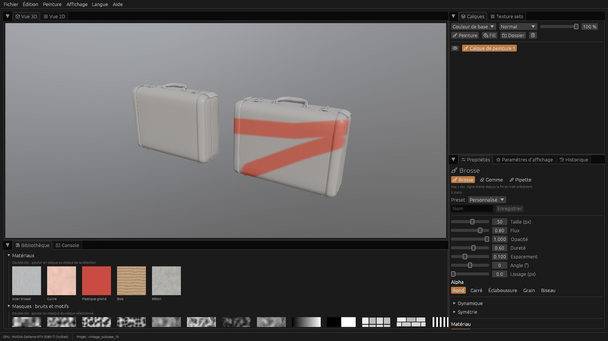
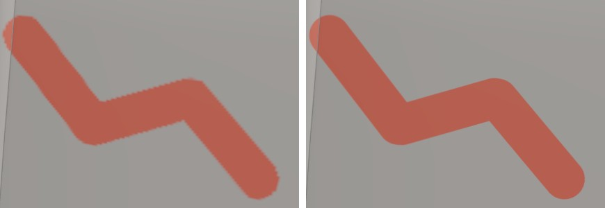

# Patine

**Texturing PBR par calques sur mesh 3D**, en Rust (wgpu, egui).

[](https://github.com/Farontir/platine/actions/workflows/ci.yml)
[](https://github.com/Farontir/platine/releases)



Patine importe un mesh, lui donne des *texture sets* (un par matériau), et compose des calques de matériaux PBR (couleur de base, metallic, roughness, normale, hauteur…). Ces calques sont des remplissages, des matériaux procéduraux ou de la peinture, avec masques et modes de fusion. Le résultat s'affiche en temps réel dans un viewport PBR éclairé par une HDRI.

> **English.** Patine is a layered PBR texturing tool for 3D meshes, written in Rust with wgpu and egui. You import a mesh, stack fills, procedural materials and paint layers with masks and blend modes, and see the result live in a PBR viewport. The interface is available in English and French (*Langue* menu). Version 0.1 is an early preview: see the release notes.

## État du projet

**Version 0.1.0 : préversion.** Le plan de développement (`docs/PLAN.md`) compte 18 jalons (M0 à M17) ; les 11 premiers (M0 à M10) sont faits :

- **Import** de meshes glTF, GLB, OBJ et FBX, avec un texture set par matériau.
- **Viewport PBR** :
  - éclairage par HDRI (.hdr, .exr), tone mapping (AgX, ACES…), ombres ;
  - fil de fer, damier UV et modes d'affichage par canal ;
  - vue 2D des UV.
- **Document** :
  - annuler et rétablir sur tout, avec un historique ;
  - projets `.patine`, enregistrement automatique et récupération après un plantage.
- **Calques** :
  - remplissages, dossiers, modes de fusion et opacité par canal ;
  - masques (remplissage, niveaux, inversion, bruits et motifs) ;
  - bibliothèque de matériaux procéduraux (acier brossé, cuivre, bois, béton…).
- **Peinture** :
  - brosse et gomme sur plusieurs canaux à la fois, alphas, masques peints ;
  - tablette graphique (pression, inclinaison, courbes) ;
  - variations aléatoires, dispersion et presets ;
  - symétrie miroir et radiale ;
  - ligne droite et pipette ;
  - peinture dans la vue 2D ;
  - relief peint en direct.
- **Indépendance de résolution** : les traits sont enregistrés, pas les pixels. Changer la résolution d'un texture set (512 à 8192) rejoue la peinture à la nouvelle taille, nette.



**À venir** :
- le baker (normales, occlusion…) ;
- les générateurs et *smart masks* ;
- le remplissage par polygone ;
- les filtres, *smart materials* ;
- l'**export** vers les moteurs de jeu (Unreal, Unity, Godot, glTF).

D'ici là, `patine_cli channels` écrit chaque canal en PNG.

## Installer

Les fichiers se trouvent sur la page [Releases](https://github.com/Farontir/platine/releases).

| Système | Fichier | Remarques |
| --- | --- | --- |
| Windows 10 ou 11 (64 bits) | `Patine-x.y.z-windows-x64-setup.exe` | Installateur : menu Démarrer, désinstallation, ouverture des `.patine` (facultative). Sans droits administrateur par défaut. |
| Windows, sans installation | `Patine-x.y.z-windows-x64-portable.zip` | Décompresser, puis lancer `patine_app.exe`. |
| Linux (64 bits) | `patine-x.y.z-linux-x64.tar.gz` | Décompresser, puis lancer `./patine_app`. Il faut un pilote Vulkan. |

Les exécutables ne sont pas signés. Au premier lancement, Windows SmartScreen peut afficher « Windows a protégé votre ordinateur » : cliquez sur *Informations complémentaires*, puis *Exécuter quand même*.

**Configuration** : une carte graphique compatible Vulkan ou DirectX 12. Les tests de performance sont faits sur une RTX 3080 Ti et une RTX A2000 portable. Une texture 4K coûte 128 Mo de mémoire graphique par canal couleur.

**En cas de problème** : le journal de chaque session est dans `%APPDATA%\Patine\logs\patine.log` sous Windows (`~/.local/share/patine/logs` sous Linux). Joignez-le à votre [issue](https://github.com/Farontir/platine/issues). Si la carte graphique pose problème, `patine_app --gpu dx12`, `--gpu vulkan` ou `--gpu software` (rendu logiciel, lent) changent d'API.

## Prise en main

1. **Fichier › Nouveau projet…** (Ctrl+N), puis choisir un mesh. Tous les modèles CC0 de [Poly Haven](https://polyhaven.com/models) conviennent.
2. **Panneau Calques** : *Fill* ajoute un remplissage, un double-clic dans la **Bibliothèque** ajoute un matériau procédural, *Peinture* ajoute un calque de peinture.
3. Peindre au clic gauche dans la vue 3D ou la vue 2D.

| Geste | Effet |
| --- | --- |
| Alt + clic gauche, milieu, droit (ou molette) | Orbite, panoramique, zoom |
| Maj + clic droit glissé | Tourner l'environnement |
| F | Cadrer le mesh |
| B, E, I | Brosse, gomme, pipette |
| [ et ], Maj + [ et ] | Taille et dureté de la brosse |
| L | Symétrie miroir X |
| Maj + clic | Ligne droite depuis la fin du trait précédent |
| Ctrl+Z, Ctrl+Y | Annuler, rétablir |

Le tutoriel complet (PDF, avec captures) se génère depuis les sources : voir plus bas.

## Ligne de commande

`patine_cli` est livré avec l'application et fonctionne sans interface :

```bash
patine_cli inspect modele.fbx
```

```bash
patine_cli channels projet.patine --out sortie --resolution 4096
```

```bash
patine_cli bench paint --symmetry 8 --mirror
```

- `inspect` décrit un mesh importé.
- `channels` écrit les canaux de chaque texture set en PNG 16 bits, à la résolution voulue.
- `bench` mesure les performances (viewport, compositeur, peinture, ouverture…).

`patine_app --help` liste les options de lancement.

## Compiler depuis les sources

Il faut Rust (la version est fixée par `rust-toolchain.toml` et installée par rustup) et, sous Linux, les bibliothèques de fenêtrage (`libxkbcommon-dev libwayland-dev libx11-dev libxcursor-dev libxrandr-dev libxi-dev`).

```bash
cargo run --release -p patine_app
```

```bash
cargo test --workspace
```

Les tests GPU utilisent l'adaptateur logiciel (WARP sous Windows, lavapipe sous Linux) : ils tournent aussi sans carte graphique. `PATINE_TEST_ADAPTER=hardware` les lance sur la vraie carte.

Le tutoriel PDF se génère avec les fichiers de test décrits dans `CLAUDE.md` (section Commandes), puis avec `scripts/manual_tests/capture_tutorial.py` et `build_tutorial.py`.

### Organisation

| Crate | Rôle |
| --- | --- |
| `patine_core` | Document (projet, calques, masques, traits), commandes annulables, format de fichier. Sans GPU. |
| `patine_mesh` | Import des meshes, topologie, BVH. |
| `patine_gpu` | Contexte wgpu, pool de textures avec budget mémoire, shaders WGSL (`shaders/`). |
| `patine_render` | Viewport PBR, environnements, vue 2D. |
| `patine_compositor` | Composition des calques et des masques sur le GPU, avec une référence CPU. |
| `patine_procedural` | Matériaux, bruits et motifs procéduraux. |
| `patine_paint` | Rastérisation des traits, dynamique, symétrie. |
| `patine_app` | Application egui : panneaux, outils, raccourcis, traductions (`i18n/`). |
| `patine_cli` | Ligne de commande et benchmarks. |

Le plan complet et les choix d'architecture sont dans [`docs/PLAN.md`](docs/PLAN.md). Chaque jalon a sa note de conception dans [`docs/design/`](docs/design/), avec ses mesures et sa checklist de tests manuels.

## Licence

Le code de Patine est distribué sous double licence, au choix :
- [MIT](LICENSE-MIT) ;
- [Apache 2.0](LICENSE-APACHE).

Sauf mention contraire, toute contribution est proposée sous ces deux mêmes licences.

**Autres contenus** :
- les environnements HDR livrés (`assets/environments`) viennent de Poly Haven, sous CC0 1.0 (voir `assets/environments/LICENSE.md`) ;
- les captures de `docs/images` montrent des modèles CC0 (voir `docs/images/README.md`) ;
- les licences des bibliothèques incluses dans les exécutables sont réunies dans `THIRD-PARTY-LICENSES.txt`, livré avec chaque version.
